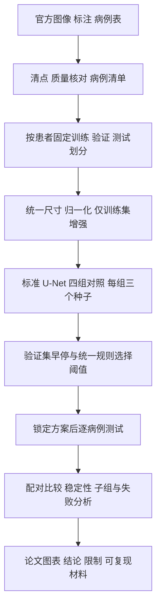

# 基于 U-Net 的乳腺超声病灶分割研究

本项目面向应用统计学本科毕业论文，使用 BrEaST 公开数据集和标准二维 U-Net，研究损失函数与数据增强对病灶分割效果、训练稳定性及不同病例表现的影响。

当前交付是**详细研究方案、论文实现流程和可检查的项目起点**。数据清点、完整训练程序、正式实验及结果尚未完成。仓库中的参数是拟采用的设计，不是实验结论；基础指标代码通过测试也不代表模型已经有效。

## 从这里阅读

| 文档 | 回答的问题 |
| --- | --- |
| [课题分析](docs/01-topic-analysis.md) | 题目研究什么，需要哪些医学与模型知识，应用统计学能贡献什么 |
| [数据处理规范](docs/02-data-protocol.md) | 下载后怎样核对文件、区分标注、划分患者并处理图像 |
| [实验与统计方案](docs/03-experiment-and-statistics.md) | 四组对照如何公平实施，怎样计算指标、比较差异、分析失败 |
| [论文实现流程](docs/04-implementation-workflow.md) | 每一步的输入、操作、输出、代码模块和验收标准 |
| [开题与论文写作依据](docs/05-proposal-writing.md) | 如何将方案写入学校模板，怎样组织综述、论文和答辩 |
| [Codex 云端配置](docs/06-codex-cloud.md) | 如何从本仓库创建可复用云端环境，区分代码验证与模型训练 |
| [资料与来源](docs/07-sources.md) | 核实过的原始资料，以及继续检索文献的方法 |
| [当前交付状态](docs/08-delivery-status.md) | 哪些工作已完成，哪些仍待实现或验证 |

## 研究主线



| 方案 | 训练损失 | 训练增强 |
| --- | --- | --- |
| A | BCE | 无 |
| B | 0.5 BCE + 0.5 Dice loss | 无 |
| C | BCE | 有 |
| D | 0.5 BCE + 0.5 Dice loss | 有 |

所有组共用患者划分及训练种子 17、42、2026，共12次正式训练。主比较预设为 D−A，其余对照用于解释两项训练策略的作用。完整设计见[实验协议](docs/03-experiment-and-statistics.md)，机器可读建议值见[实验配置](configs/experiment_plan.json)。

## 立即可运行的检查

需要 Python 3.10 或更新版本。基础检查只使用标准库，不安装 TensorFlow，不下载数据，不运行正式训练。

```bash
bash scripts/setup_codex.sh
python3 scripts/check_environment.py
```

这些命令检查目录与配置、执行二值分割指标的边界情况测试。完整 U-Net 和训练流程仍按实现文档逐步建设。

## 项目组织

```text
docs/                    研究方案与实现说明
configs/                 拟采用的实验配置
src/breast_unet/          基础指标代码 后续扩展训练模块
scripts/                 项目与环境检查
tests/                   数值和边界条件测试
data/                    数据存放规范 原始文件不进版本库
reports/                 结果产出规范 当前无正式实验结果
.github/workflows/       基础自动检查
AGENTS.md                本地和云端 Codex 的项目约定
```

## 使用边界

- 本课题评价目标病灶区域的分割，不以分割成绩代替良恶性诊断准确率。
- 官方资料报告256例，其中4例正常。最终纳入数量必须以实际下载和质量核对为准。
- 标注是参考答案，并不意味着临床边界毫无不确定性。
- 数据、权重、个人学校材料与本机环境均不随本次提交上传。引用公开数据时保留原始出处和许可说明。
- 所有研究文档按逻辑步骤组织，不包含日历或周计划。

数据入口：[TCIA Breast-Lesions-USG](https://www.cancerimagingarchive.net/collection/breast-lesions-usg/)。
